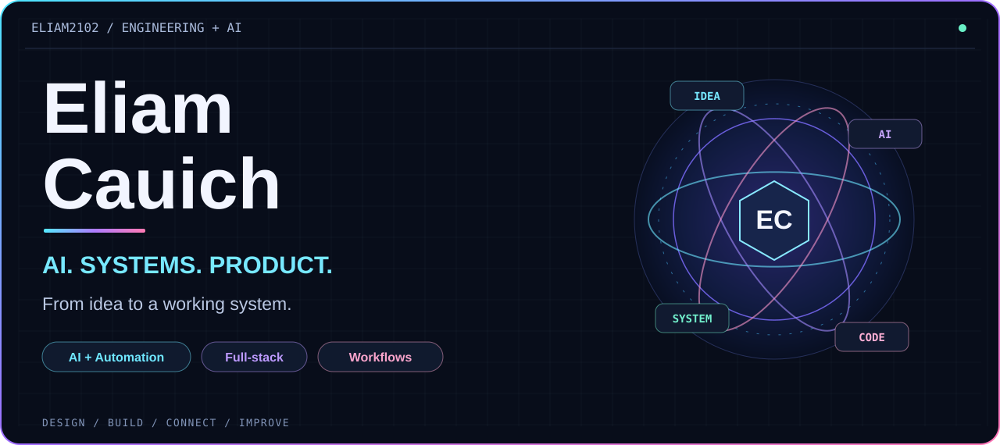
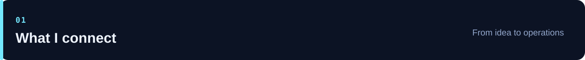
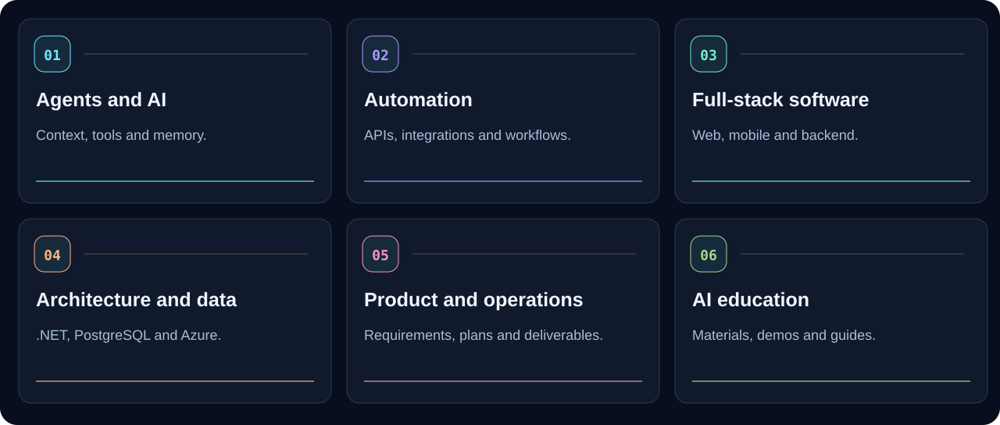
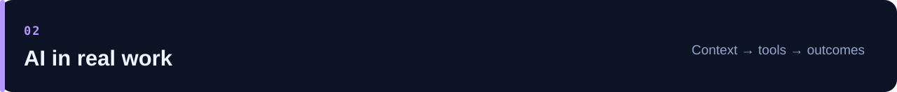
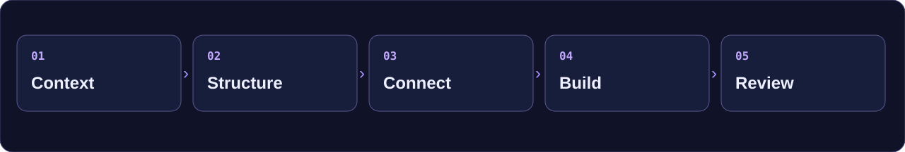
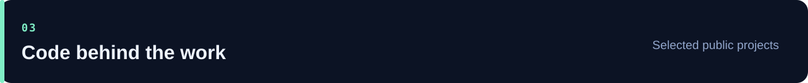
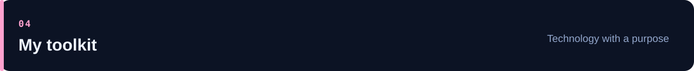

  
  

<picture>
  <source media="(max-width: 600px)" srcset="./assets/hero-en-mobile.svg" />
  
</picture>

# I build products that connect interfaces, systems, and AI agents.

I'm **Eliam Cauich Villanueva**. My work brings together software development, business processes, and artificial intelligence: full-stack applications, business systems, integrations, and operational tools.

I also contribute to solution design, technical coordination, and educational materials about applied AI. I work collaboratively with AI-assisted development tools, from requirements through deliverable review.

**[Capabilities](#capabilities) · [Cowork and applied AI](#cowork-and-applied-ai) · [Projects](#projects) · [Stack](#stack)**

<picture>
  <source media="(max-width: 600px)" srcset="./assets/capability-map-en-mobile.svg" />
  
</picture>

<strong>Explore the capabilities in detail</strong>

- **AI agents:** integrating models with tools, context, conversational memory, and semantic search.
- **Automation:** connecting APIs, webhooks, scheduled jobs, messaging, and document generation.
- **Full-stack software:** web interfaces, mobile applications, APIs, and data persistence.
- **Business systems:** working with modular architecture, separation of concerns, events, and access control.
- **Product and coordination:** turning processes into requirements, user stories, acceptance criteria, and implementation plans.
- **Applied AI and education:** materials, demonstrations, and guides that bring AI tools into everyday work.

I use **Claude Cowork, Codex, and ChatGPT** to structure knowledge, support software development, and prepare deliverables. My work with connected tools includes workflows across documents, requirements, tasks, and operational follow-up.

<picture>
  <source media="(max-width: 600px)" srcset="./assets/workflow-en-mobile.svg" />
  
</picture>

- **From business needs to implementation:** processes, data models, rules, user stories, and clear criteria.
- **From context to action:** instructions, connected tools, and deliverables that can be reviewed.
- **From draft to a verifiable solution:** code review, tests, documentation, and changes checked against requirements.

Beyond the public code, I also work on business systems and integrations that are not part of this public portfolio.

<table>
<tr>
<td width="50%" valign="top">

### 🧠 Agents + backend
**[norder-crm-api](https://github.com/Eliam2102/norder-crm-api)**

Backend with a Gemini agent, tool execution, conversational memory, vector retrieval, and PDF document generation.

**Node.js · Express · Prisma · PostgreSQL/pgvector**

[Explore the agent implementation →](https://github.com/Eliam2102/norder-crm-api/blob/main/src/agent/runner.js)

</td>
<td width="50%" valign="top">

### ⚙️ Integrations + automation
**[norder-api](https://github.com/Eliam2102/norder-api)**

API with availability, appointments, Stripe integration, and scheduled jobs that update states through database transactions.

**TypeScript · Express · Prisma · Stripe**

[Explore the automation →](https://github.com/Eliam2102/norder-api/blob/main/src/services/cron.service.ts)

</td>
</tr>
<tr>
<td width="50%" valign="top">

### 🪐 Mobile + data exploration
**[NASA Explorer](https://github.com/Eliam2102/NASA-explorer-app)**

Application connecting multiple NASA APIs. Data, domain, and presentation layers, with storage adapted to web and mobile.

**React Native · Expo · TypeScript**

[Explore the project →](https://github.com/Eliam2102/NASA-explorer-app)

</td>
<td width="50%" valign="top">

### 📱 Productivity + native features
**[Personal CRM](https://github.com/Eliam2102/CRM-personal)**

Contact and calendar management with local notification services. Organized around features and use cases.

**React Native · Expo · TypeScript**

[Explore the project →](https://github.com/Eliam2102/CRM-personal)

</td>
</tr>
<tr>
<td width="50%" valign="top">

### 🛍️ Commerce + web experience
**[BigCart](https://github.com/Eliam2102/E-commerce-BigCart)**

E-commerce frontend with a catalog, product details, shopping cart, forms, and API integration.

**React · TypeScript · Redux Toolkit**

[Explore the project →](https://github.com/Eliam2102/E-commerce-BigCart)

</td>
<td width="50%" valign="top">

### ✨ Design + motion
**[Celestún Adventures](https://github.com/Eliam2102/celestun-adventures)**

Tourism experience with tours, a gallery, a blog, animations, and a contact flow through WhatsApp.

**React · JavaScript · GSAP · Tailwind CSS**

[Explore the project →](https://github.com/Eliam2102/celestun-adventures)

</td>
</tr>
</table>

| Area | Technologies and tools I work with |
| :--- | :--- |
| **AI and assisted development** | Gemini, Claude Cowork, Codex, ChatGPT, tool calling, memory, and embeddings |
| **Web and mobile** | TypeScript, JavaScript, React, Next.js, React Native, Expo |
| **Backend** | Node.js, Express, Python, FastAPI, C#, .NET |
| **Data** | PostgreSQL, pgvector, Prisma, Entity Framework Core |
| **Interfaces and state** | Tailwind CSS, shadcn/ui, Material UI, GSAP, Redux Toolkit, Zustand |
| **Infrastructure** | Docker, Azure, Bicep, Entra ID, Service Bus |
| **Quality and coordination** | Git/GitHub, tests, ADRs, documentation, Notion, ClickUp |

---

  <strong>Applied AI + engineering + product thinking.</strong> 
  <a href="https://github.com/Eliam2102?tab=repositories">Explore my repositories</a> ·
  <a href="https://github.com/Eliam2102">Leer en español</a>

