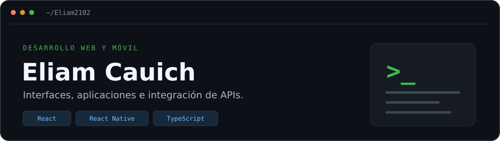

# Hola, soy Eliam

Desarrollo aplicaciones web y móviles con **React, React Native y TypeScript**. En mis repositorios encontrarás proyectos de comercio electrónico, productividad y exploración de datos mediante APIs.

[Proyectos destacados](#proyectos-destacados) · [Tecnologías](#tecnologías) · [Todos los repositorios](https://github.com/Eliam2102?tab=repositories)

## Perfil en una mirada

```text
eliam2102@github
│
├── Web       React · TypeScript · JavaScript
├── Móvil     React Native · Expo
└── Enfoque   Interfaces · Gestión de estado · Integración de APIs
```

## Proyectos destacados

<table>
<tr>
<td width="50%" valign="top">

### [NASA Explorer](https://github.com/Eliam2102/NASA-explorer-app)

Aplicación para explorar imágenes astronómicas, datos de Marte y eventos del clima espacial mediante APIs de la NASA.

**React Native · Expo · TypeScript**

[Explorar el código →](https://github.com/Eliam2102/NASA-explorer-app)

</td>
<td width="50%" valign="top">

### [BigCart](https://github.com/Eliam2102/E-commerce-BigCart)

Interfaz de comercio electrónico con catálogo, detalle de productos, carrito de compras y gestión de estado con Redux Toolkit.

**React · TypeScript · Redux Toolkit**

[Explorar el código →](https://github.com/Eliam2102/E-commerce-BigCart)

</td>
</tr>
<tr>
<td width="50%" valign="top">

### [CRM Personal](https://github.com/Eliam2102/CRM-personal)

Aplicación móvil para organizar contactos y calendario. Código organizado por funcionalidades, con separación entre datos, dominio y presentación.

**React Native · Expo · TypeScript**

[Explorar el código →](https://github.com/Eliam2102/CRM-personal)

</td>
<td width="50%" valign="top">

### [Celestún Adventures](https://github.com/Eliam2102/celestun-adventures)

Sitio web turístico con catálogo de tours, galería y blog. Interfaz construida con componentes React y estilos con Tailwind CSS.

**React · JavaScript · Vite · Tailwind CSS**

[Explorar el código →](https://github.com/Eliam2102/celestun-adventures)

</td>
</tr>
</table>

## Tecnologías

| Área | Tecnologías presentes en mis proyectos |
| :--- | :--- |
| **Web** | React, TypeScript, JavaScript, Vite |
| **Móvil** | React Native, Expo, React Navigation |
| **Interfaces** | Material UI, Tailwind CSS, Framer Motion |
| **Estado** | Redux Toolkit, Zustand |

## Más proyectos

- [Notes](https://github.com/Eliam2102/notes-app): aplicación de notas con React, TypeScript y componentes de arrastrar y soltar.
- [Explorar todos mis repositorios públicos](https://github.com/Eliam2102?tab=repositories).
