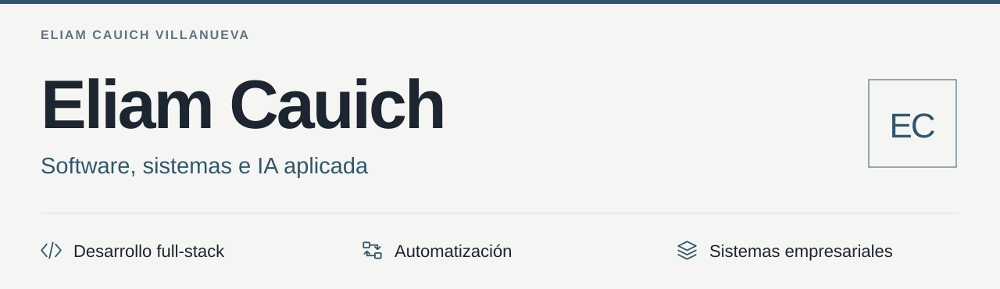
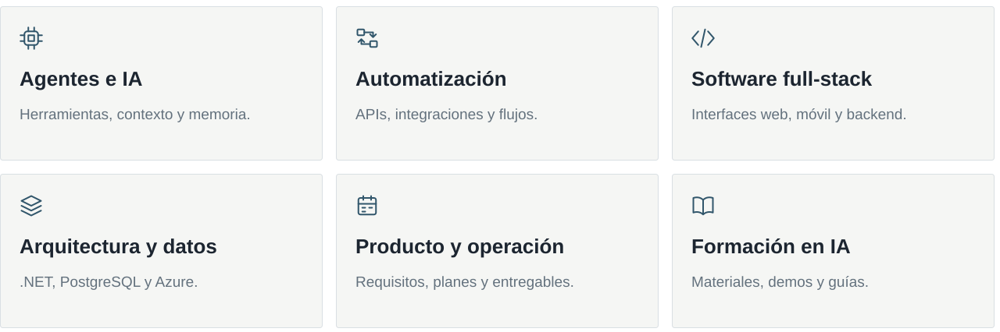

  
  

<picture>
  <source media="(max-width: 600px)" srcset="./assets/editorial/hero-es-mobile.svg" />
  
</picture>

## Desarrollo de software, sistemas e IA aplicada

Soy **Eliam Cauich Villanueva**. Desarrollo aplicaciones web y móviles, APIs, sistemas empresariales e integraciones. Trabajo con agentes de IA y automatización de procesos, desde la definición de requisitos hasta la implementación y revisión.

También participo en la coordinación técnica y preparo materiales sobre IA aplicada. Los proyectos de este perfil incluyen trabajo colaborativo y desarrollo asistido por IA.

**[Capacidades](#user-content-capacidades) · [Cowork e IA aplicada](#user-content-cowork-e-ia-aplicada) · [Proyectos](#user-content-proyectos) · [Stack](#user-content-stack)**

##  Capacidades

<picture>
  <source media="(max-width: 600px)" srcset="./assets/editorial/capability-map-es-mobile.svg" />
  
</picture>

<strong>Ver las capacidades en detalle</strong>

- **Agentes e IA:** integración de modelos con herramientas, contexto, memoria conversacional y búsqueda semántica.
- **Automatización:** conexión de APIs, webhooks, tareas programadas, mensajería y generación de documentos.
- **Software full-stack:** interfaces web, aplicaciones móviles, APIs y persistencia de datos.
- **Sistemas empresariales:** trabajo con arquitectura modular, separación de responsabilidades, eventos y control de acceso.
- **Producto y coordinación:** traducción de procesos en requisitos, historias de usuario, criterios de aceptación y planes de implementación.
- **IA aplicada y formación:** materiales, demostraciones y guías para llevar herramientas de IA al trabajo cotidiano.

##  Cowork e IA aplicada

Uso **Claude Cowork, Codex y ChatGPT** para estructurar conocimiento, apoyar el desarrollo de software y preparar entregables. Mi trabajo con herramientas conectadas incluye flujos entre documentos, requisitos, tareas y seguimiento operativo.

<picture>
  <source media="(max-width: 600px)" srcset="./assets/editorial/workflow-es-mobile.svg" />
  
</picture>

- **Análisis:** procesos, modelos de datos, reglas de negocio, historias y criterios de aceptación.
- **Flujos de trabajo:** instrucciones, herramientas conectadas y preparación de entregables.
- **Revisión:** código, pruebas, documentación y ajustes según los requisitos.

Además del código público, trabajo en sistemas empresariales e integraciones que no forman parte de este portafolio.

##  Proyectos seleccionados

<table>
<tr>
<td width="50%" valign="top">

###  Agentes y backend
**[norder-crm-api](https://github.com/Eliam2102/norder-crm-api)**

Backend con agente Gemini, ejecución de herramientas, memoria conversacional, recuperación vectorial y generación de documentos PDF.

**Node.js · Express · Prisma · PostgreSQL/pgvector**

[Ver implementación del agente →](https://github.com/Eliam2102/norder-crm-api/blob/main/src/agent/runner.js)

</td>
<td width="50%" valign="top">

###  Integraciones y automatización
**[norder-api](https://github.com/Eliam2102/norder-api)**

API con disponibilidad, citas, integración de Stripe y tareas programadas que actualizan estados mediante transacciones.

**TypeScript · Express · Prisma · Stripe**

[Ver automatización →](https://github.com/Eliam2102/norder-api/blob/main/src/services/cron.service.ts)

</td>
</tr>
<tr>
<td width="50%" valign="top">

###  Móvil y exploración de datos
**[NASA Explorer](https://github.com/Eliam2102/NASA-explorer-app)**

Aplicación que conecta distintas APIs de la NASA. Capas de datos, dominio y presentación, con almacenamiento adaptado a web y móvil.

**React Native · Expo · TypeScript**

[Explorar el proyecto →](https://github.com/Eliam2102/NASA-explorer-app)

</td>
<td width="50%" valign="top">

###  Productividad y funciones nativas
**[CRM Personal](https://github.com/Eliam2102/CRM-personal)**

Organización de contactos y calendario, con servicios de notificaciones locales. Estructura por funcionalidades y casos de uso.

**React Native · Expo · TypeScript**

[Explorar el proyecto →](https://github.com/Eliam2102/CRM-personal)

</td>
</tr>
<tr>
<td width="50%" valign="top">

###  Comercio y experiencia web
**[BigCart](https://github.com/Eliam2102/E-commerce-BigCart)**

Frontend de comercio electrónico con catálogo, detalle de productos, carrito, formularios y consumo de API.

**React · TypeScript · Redux Toolkit**

[Explorar el proyecto →](https://github.com/Eliam2102/E-commerce-BigCart)

</td>
<td width="50%" valign="top">

###  Diseño y motion
**[Celestún Adventures](https://github.com/Eliam2102/celestun-adventures)**

Experiencia turística con catálogo de tours, galería, blog, animaciones y un recorrido de contacto mediante WhatsApp.

**React · JavaScript · GSAP · Tailwind CSS**

[Explorar el proyecto →](https://github.com/Eliam2102/celestun-adventures)

</td>
</tr>
</table>

##  Tecnologías y herramientas

| Área | Tecnologías y herramientas con las que trabajo |
| :--- | :--- |
| **IA y desarrollo asistido** | Gemini, Claude Cowork, Codex, ChatGPT, tool calling, memoria y embeddings |
| **Web y móvil** | TypeScript, JavaScript, React, Next.js, React Native, Expo |
| **Backend** | Node.js, Express, Python, FastAPI, C#, .NET |
| **Datos** | PostgreSQL, pgvector, Prisma, Entity Framework Core |
| **Interfaces y estado** | Tailwind CSS, shadcn/ui, Material UI, GSAP, Redux Toolkit, Zustand |
| **Infraestructura** | Docker, Azure, Bicep, Entra ID, Service Bus |
| **Calidad y coordinación** | Git/GitHub, pruebas, ADRs, documentación, Notion, ClickUp |

---

  <strong>Eliam Cauich Villanueva</strong> 
  <a href="https://github.com/Eliam2102?tab=repositories">Explora mis repositorios</a> ·
  <a href="./README.en.md">Read in English</a>

